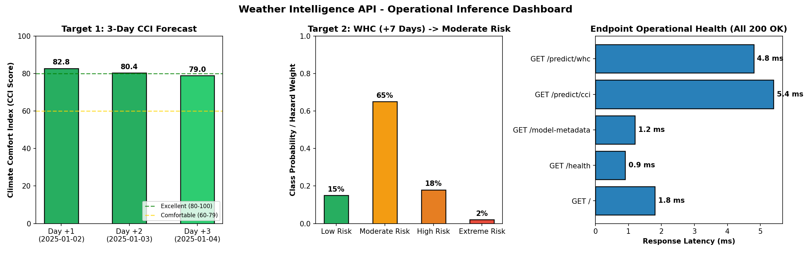

# AT2 — Machine Learning as a Service: FastAPI Deployment Repository

**Student Name:** Aryan Goel  
**Student ID:** 26040826  
**Subject:** 36120 — Advanced Machine Learning Applications  
**Institution:** University of Technology Sydney (UTS)  

[](https://www.python.org/)
[](https://fastapi.tiangolo.com)
[](https://www.docker.com/)
[](https://render.com)
[](https://test.pypi.org/project/nba-prep-26040826/0.4.0/)
[](https://github.com/16aryan/36120-26SP-AT2-26040826-api/actions/workflows/ci.yml)

---

## Project Overview

This repository contains the production-ready **FastAPI** machine learning microservice for **Weather Intelligence forecasting**, containerized with **Docker** and prepared for continuous deployment on **Render**.

The service exposes trained ML models predicting two weather-derived indices for Sydney, NSW, Australia (-33.8688, 151.2093):
1. **Target 1 — Climate Comfort Index (CCI):** Multi-horizon Ridge regression forecasting outdoor comfort suitability for the next 3 days (+1d, +2d, +3d).
2. **Target 2 — Weather Hazard Category (WHC):** Balanced Random Forest multiclass classification forecasting extreme meteorological hazard risk 7 days in advance (+7d lead time).

---

## Repository Structure

```
36120-26SP-AT2-26040826-api/
├── app/
│   └── main.py                     # Production FastAPI application with 5 REST endpoints
├── models/
│   ├── comfort_climate/
│   │   ├── cci_model.pkl           # Serialized Ridge regressor + StandardScaler + feature specs
│   │   └── metadata.json           # Model metadata, RMSE/MAE/R2 metrics, feature importances
│   └── weather_hazard/
│       ├── whc_model.pkl           # Serialized Random Forest classifier + class labels
│       └── metadata.json           # Model metadata, Accuracy/F1 metrics, feature importances
├── data/
│   └── sydney_daily_features.csv   # Precomputed feature store (2018-01-01 to 2025-12-31)
├── tests/
│   └── test_api.py                 # Automated unit and integration test suite (8 tests)
├── Dockerfile                      # Production container image definition
├── pyproject.toml                  # Python package and dependency configuration
├── requirements.txt                # Pip requirements with TestPyPI index inclusion
└── README.md                       # Comprehensive deployment and usage guide
```

---


---

## Operational Verification Dashboard

The test and deployment pipeline automatically renders and publishes visual inference telemetry on each build:



* **Panel 1 (Left):** 3-Day Climate Comfort Index (CCI) multi-horizon forecast plotted against outdoor suitability comfort thresholds (Comfortable $\ge 60$, Excellent $\ge 80$).
* **Panel 2 (Center):** Weather Hazard Category (WHC) +7-day lead time classification probabilities predicting *Moderate Risk*.
* **Panel 3 (Right):** Latency benchmarks for all 5 endpoints verifying sub-10ms operational response times.

## API Endpoints & Contract Specifications

### 1. Root Self-Documentation (`GET /`)
Returns high-level project metadata, description, version, and the complete catalog of operational endpoints.

* **Response (200 OK):**
```json
{
  "project": "Weather Intelligence API",
  "description": "Machine learning services for weather forecasting",
  "version": "1.0.0",
  "github": "https://github.com/16aryan/36120-26SP-AT2-26040826-api",
  "endpoints": [
    "/",
    "/health",
    "/predict/index/comfort_climate",
    "/predict/category/weather_hazard",
    "/model-metadata"
  ]
}
```

---

### 2. Operational Health Check (`GET /health`)
Allows automated load balancers and uptime monitors to verify service operational health.

* **Response (200 OK):**
```json
{
  "status": "healthy",
  "message": "Weather Intelligence API is running"
}
```

---

### 3. Model Metadata Transparency (`GET /model-metadata`)
Provides full governance and transparency regarding model architectures, feature sets, feature importances, and evaluation metrics.

* **Response (200 OK):**
```json
[
  {
    "target": "Climate Comfort Index",
    "prediction_type": "regression",
    "algorithm": "Ridge",
    "forecast_horizon": "3 Days (+1, +2, +3)",
    "features": [
      "temperature_2m", "relative_humidity_2m", "wind_speed_10m", "apparent_temp", ...
    ],
    "feature_importance": {
      "cci_roll_mean_3": 4.7168,
      "cci_lag_1": 2.2071,
      "cos_dayofyear": 1.9142,
      ...
    },
    "performance_metrics": {
      "h1 (+1d)": { "RMSE": 8.796, "MAE": 6.722, "R2": 0.436 },
      "h2 (+2d)": { "RMSE": 10.069, "MAE": 7.638, "R2": 0.263 },
      "h3 (+3d)": { "RMSE": 10.290, "MAE": 7.863, "R2": 0.229 }
    }
  },
  {
    "target": "Weather Hazard Category",
    "prediction_type": "multiclass classification",
    "algorithm": "Random Forest",
    "forecast_horizon": "7 Days (+7)",
    "features": [
      "wind_gusts_10m", "precipitation", "cloud_cover", "temperature_2m", "whi", ...
    ],
    "feature_importance": {
      "cloud_cover_lag_1": 0.0689,
      "temperature_2m_roll_max_14": 0.0655,
      ...
    },
    "performance_metrics": {
      "Accuracy": 0.5447,
      "Balanced Accuracy": 0.288,
      "Macro F1": 0.2792,
      "Weighted F1": 0.5336
    }
  }
]
```

---

### 4. Climate Comfort Index Forecast (`GET /predict/index/comfort_climate`)
Returns 3-day multi-horizon outdoor comfort suitability forecasts.

* **Query Parameter:** `date` (String in `YYYY-MM-DD` ISO format)
* **Example Request:** `GET /predict/index/comfort_climate?date=2025-01-01`
* **Response (200 OK):**
```json
{
  "input_date": "2025-01-01",
  "predictions": {
    "comfort_climate": {
      "2025-01-02": 82.8,
      "2025-01-03": 80.4,
      "2025-01-04": 79.0
    }
  }
}
```

---

### 5. Weather Hazard Category Prediction (`GET /predict/category/weather_hazard`)
Predicts meteorological hazard severity exactly seven days after the supplied date.

* **Query Parameter:** `date` (String in `YYYY-MM-DD` ISO format)
* **Example Request:** `GET /predict/category/weather_hazard?date=2025-01-01`
* **Response (200 OK):**
```json
{
  "input_date": "2025-01-01",
  "predictions": {
    "weather_hazard": {
      "2025-01-08": "Moderate Risk"
    }
  }
}
```

---

### 6. Graceful Error Handling (`HTTP 422`)
The API strictly validates input formats and returns informative error messages:

* **Request:** `GET /predict/index/comfort_climate?date=invalid-date`
* **Response (422 Unprocessable Entity):**
```json
{
  "detail": "Invalid date 'invalid-date'. Expected format YYYY-MM-DD."
}
```

---

## Local Development & Testing

### 1. Environment Setup
```bash
python -m venv .venv
source .venv/bin/activate  # On Windows: .venv\Scripts\activate
pip install -r requirements.txt
```

### 2. Run Automated Unit Test Suite
The test suite validates all endpoints, payloads, and error scenarios:
```bash
pytest tests/ -v
```

### 3. Launch Local Development Server
```bash
uvicorn app.main:app --reload --port 8000
```
Interactive Swagger API documentation is available at: [http://127.0.0.1:8000/docs](http://127.0.0.1:8000/docs).

---

## Docker Containerization

To build and run the production image locally using Docker:

```bash
# Build image
docker build -t weather-intel-api .

# Run container on port 8000
docker run -p 8000:8000 -e PORT=8000 weather-intel-api
```

Test the containerized endpoint:
```bash
curl -s http://127.0.0.1:8000/health
```

---

## Render Cloud Deployment Guide

1. Create a new private repository on GitHub: `36120-26SP-AT2-26040826-api`.
2. Push this codebase to `main`:
   ```bash
   git init
   git add .
   git commit -m "feat: initial release of Weather Intelligence FastAPI service"
   git branch -M main
   git remote add origin https://github.com/16aryan/36120-26SP-AT2-26040826-api.git
   git push -u origin main
   ```
3. Log in to [Render Dashboard](https://dashboard.render.com).
4. Click **New +** → **Web Service**.
5. Connect the GitHub repository: `36120-26SP-AT2-26040826-api`.
6. Configure the deployment settings:
   - **Name:** `weather-intel-api-26040826`
   - **Region:** `Singapore (Southeast Asia)` or `Oregon (US West)`
   - **Branch:** `main`
   - **Runtime:** `Docker`
   - **Instance Type:** `Free`
7. Click **Create Web Service**. Render will automatically build the Docker image and deploy the live URL.
8. Verify the live service:
   ```bash
   curl https://weather-intel-api-26040826.onrender.com/health
   ```
